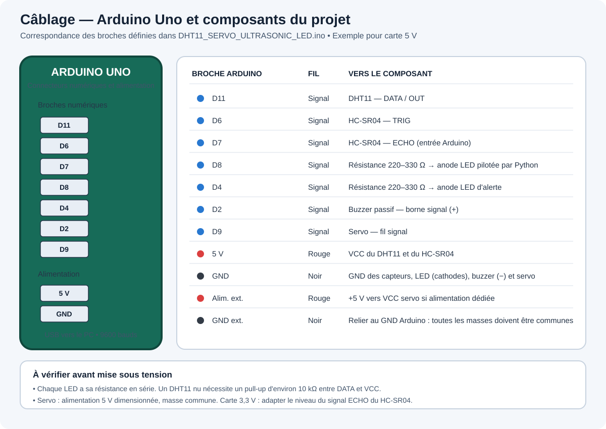

# Tableau de bord Arduino : DHT11, servo, ultrasons et LED

Ce projet associe un programme Arduino à une interface graphique Python. L'Arduino lit les capteurs, commande le servo et déclenche une alerte de proximité. L'interface affiche les mesures et permet de piloter une LED et le servo par liaison USB série.

> Le schéma de câblage ci-dessous est un exemple basé sur un Arduino Uno compatible 5 V. Vérifiez les tensions et le brochage si votre carte ou vos modules sont différents.

## Sommaire

- [Fonctionnement général](#fonctionnement-général)
- [Matériel](#matériel)
- [Câblage](#câblage)
- [Logiciels et bibliothèques](#logiciels-et-bibliothèques)
- [Installation et démarrage](#installation-et-démarrage)
- [Explication des programmes](#explication-des-programmes)
- [Protocole série](#protocole-série)
- [Dépannage et limites actuelles](#dépannage-et-limites-actuelles)

## Fonctionnement général

1. L'Arduino mesure la distance avec le capteur ultrason toutes les 500 ms.
2. Si une mesure valide est inférieure à 15 cm, il fait clignoter la LED d'alerte et produit un bip. Hors de cette zone, il éteint la LED et arrête le buzzer.
3. Toutes les quatre mesures (environ deux secondes), il lit l'humidité et la température du DHT11, calcule l'indice de chaleur, puis envoie les mesures en JSON sur le port série.
4. L'application Python lit les lignes JSON et actualise les valeurs affichées, le thermomètre et le voyant de proximité.
5. Les commandes de l'interface sont envoyées à l'Arduino sur cette même liaison série.

## Matériel

- Une carte Arduino Uno ou compatible disposant de broches numériques 5 V.
- Un capteur de température et d'humidité **DHT11** (module ou capteur nu).
- Un capteur de distance ultrason **HC-SR04**.
- Un micro-servo compatible avec `Servo.h` (par exemple SG90).
- Une LED commandée depuis l'interface et une LED d'alerte.
- Une résistance en série pour chaque LED, typiquement entre 220 et 330 Ω.
- Un buzzer passif compatible avec une commande `tone()` à 400 Hz.
- Des fils Dupont, une breadboard et un câble USB pour l'Arduino.
- Une alimentation 5 V adaptée au servo si le courant demandé dépasse ce que la carte peut fournir.

## Câblage

Le brochage ci-dessous correspond aux constantes définies dans `DHT11_SERVO_ULTRASONIC_LED.ino`.



| Élément | Broche du module | Broche Arduino |
|---|---|---|
| DHT11 | DATA / OUT | D11 |
| DHT11 | VCC | 5 V |
| DHT11 | GND | GND |
| HC-SR04 | TRIG | D6 |
| HC-SR04 | ECHO | D7 |
| HC-SR04 | VCC | 5 V |
| HC-SR04 | GND | GND |
| LED pilotée par Python | Anode (+), via résistance | D8 |
| LED pilotée par Python | Cathode (−) | GND |
| LED d'alerte de distance | Anode (+), via résistance | D4 |
| LED d'alerte de distance | Cathode (−) | GND |
| Buzzer passif | Signal (+) | D2 |
| Buzzer passif | GND (−) | GND |
| Servo | Signal | D9 |
| Servo | VCC | 5 V adapté au servo |
| Servo | GND | GND commun |

**Précautions de câblage**

- Chaque LED doit avoir sa propre résistance en série. Ne branchez pas une LED directement entre une broche et la masse.
- Si le DHT11 est un capteur nu (et non un module déjà équipé), ajoutez une résistance de tirage d'environ 10 kΩ entre DATA et VCC.
- Un servo peut provoquer des redémarrages s'il est alimenté par la broche 5 V de l'Arduino. Une alimentation 5 V séparée adaptée au servo est préférable ; reliez alors sa masse à la masse de l'Arduino.
- Le HC-SR04 fournit un signal ECHO proche de 5 V. La connexion directe indiquée convient à un Arduino Uno 5 V ; une carte 3,3 V peut nécessiter un diviseur de tension sur ECHO.
- Respectez les polarités et les limites de courant des composants. Un buzzer de forte puissance peut nécessiter un transistor de commande plutôt qu'une connexion directe à D2.

## Logiciels et bibliothèques

### Python

Le fichier `requirements.txt` liste les paquets Python installés par pip :

- `customtkinter` : fenêtre et composants graphiques.
- `Pillow` : dépendance de l'interface CustomTkinter et outils d'image.
- `pyserial` : communication série avec l'Arduino.

`tkinter` est inclus avec une installation standard de Python pour Windows ; il n'est donc pas installé depuis `requirements.txt`.

### Arduino

Dans l'IDE Arduino, installez la bibliothèque **DHT sensor library** d'Adafruit (ainsi que **Adafruit Unified Sensor** si l'IDE la demande). `Servo.h` est généralement fournie avec l'environnement Arduino. Le fichier inclut aussi `Wire.h`, mais ne l'utilise pas directement.

## Installation et démarrage

### Installer l'application Python

Depuis le dossier du projet, dans PowerShell :

```powershell
py -m venv .venv
.\.venv\Scripts\Activate.ps1
python -m pip install --upgrade pip
python -m pip install -r requirements.txt
python main.py
```

Si la politique PowerShell empêche l'activation, appelez directement l'interpréteur de l'environnement :

```powershell
.\.venv\Scripts\python.exe -m pip install -r requirements.txt
.\.venv\Scripts\python.exe main.py
```

Dans VS Code, l'interpréteur de l'espace de travail est configuré sur `.venv\Scripts\python.exe`.

### Téléverser le programme Arduino

1. Ouvrez `Arduino code/DHT11_SERVO_ULTRASONIC_LED.ino` dans l'IDE Arduino.
2. Sélectionnez le modèle de carte et son port USB.
3. Vérifiez que la bibliothèque DHT est installée, puis téléversez le programme.
4. Fermez le Moniteur série Arduino avant de lancer l'application Python : un seul programme peut généralement utiliser le port à la fois.
5. Vérifiez que le port de la carte correspond à `COM4`, valeur actuellement passée à `SerialManager.connect_serial()` dans `main.py`. Si nécessaire, modifiez cet argument.
6. Démarrez l'application. La vitesse série doit être de **9600 bauds** des deux côtés.

## Explication des programmes

### `main.py` — interface et liaison série

Les imports chargent CustomTkinter, les threads et les composants `Thermometer`, `CircularCanvas` et `SerialManager` du fichier utilitaire.

#### Classe `App`

- **`__init__()`** — Initialise la fenêtre de 900 × 650 pixels et le dictionnaire contenant température, humidité, indice de chaleur et distance. Construit les cadres, étiquettes, voyant, thermomètre, boutons de LED, menu de mode servo et curseur d'angle. Crée le gestionnaire série, puis lance sa connexion à `COM4` à 9600 bauds dans un thread d'arrière-plan. Enregistre aussi la fermeture de la fenêtre pour fermer proprement le port.
- **`send(msg)`** — Délègue l'envoi de commande à `SerialManager.send()`.
- **`change_servo_mode(mode)`** — Convertit le choix du menu en `M1` (automatique) ou `M0` (manuel), puis l'envoie.
- **`srv_slider(val)`** — Convertit la position du curseur en angle entier et envoie une commande `S<angle>`.
- **`update_gui()`** — Actualise les textes des mesures et la température du thermomètre. Colore le voyant en rouge si la distance est inférieure à 15 cm, sinon en vert, puis se reprogramme 500 ms plus tard.
- **`close()`** — Arrête le gestionnaire série puis détruit la fenêtre.

L'exécution directe du fichier crée une instance de `App` et démarre la boucle d'événements Tkinter avec `mainloop()`.

### `Tools_arduino_tkinter.py` — composants graphiques et gestion série réutilisables

#### Classe `Thermometer`

Ce widget dessine un thermomètre dans un `Canvas` Tkinter inclus dans un cadre CustomTkinter.

- **`__init__(...)`** — Enregistre les bornes et la température initiale, crée le canvas et le label de température, puis dessine le thermomètre.
- **`draw_thermometer()`** — Efface et redessine le bulbe, le tube, le mercure proportionnel à la plage de températures, les graduations et la jonction du tube.
- **`draw_graduations(left, top, right, bottom)`** — Dessine des graduations principales tous les 10 °C et mineures tous les 2 °C, avec leurs positions calculées sur le tube.
- **`get_temperature_color(temp)`** — Choisit une couleur de froid à chaud selon des seuils de température.
- **`set_temperature(temp)`** — Limite la température aux valeurs min/max, actualise le texte et sa couleur puis redessine le widget.
- **`get_text_color(temp)`** — Renvoie rouge au-dessus de 35 °C, bleu sous 0 °C et blanc autrement.
- **`get_temperature()`** — Renvoie la température actuellement mémorisée par le widget.

#### Classe `CircularProgressBar`

Composant autonome de progression circulaire, défini dans le fichier utilitaire mais non utilisé par `main.py`.

- **`__init__(...)`** — Initialise la taille, les couleurs et la progression à 0, crée le canvas et les étiquettes, puis construit le cercle et ses contrôles.
- **`draw_circle()`** — Dessine le cercle de fond et l'arc correspondant à la progression, en commençant en haut.
- **`create_controls()`** — Crée les boutons − et + (pas de 10) et un curseur de 0 à 100.
- **`set_progress(value)`** — Enregistre la valeur, synchronise le curseur et actualise l'affichage.
- **`on_slider_change(value)`** — Convertit la valeur du curseur en nombre flottant et actualise l'affichage.
- **`update_display()`** — Actualise le pourcentage affiché, choisit une couleur rouge, jaune ou verte selon la valeur, puis redessine l'arc.

#### Classe `CircularCanvas`

Petit voyant circulaire utilisé par `App` pour l'alerte de distance.

- **`__init__(master, size, bg_color, ...)`** — Crée un canvas Tkinter et un cercle initialement vert ; conserve l'identifiant du cercle pour permettre à l'application d'en changer la couleur.
- **`draw_progress(percentage)`** — Ajoute ou remplace un arc de progression circulaire.
- **`add_text(text, font_size)`** — Ajoute un texte au centre du canvas.

#### Classe `SerialManager`

Gestionnaire chargé de la connexion série, des commandes, de la lecture JSON et de la reconnexion automatique utilisée par `App`.

- **`__init__(parent_app)`** — Initialise la référence à l'application, l'état de connexion, le thread et le compteur de tentatives (maximum cinq).
- **`connect_serial(port, baudrate)`** — Utilise le port donné, mémorisé ou détecté automatiquement ; ouvre le port, attend deux secondes le redémarrage éventuel de l'Arduino, puis démarre les threads de surveillance et de lecture. Le firmware n'ayant pas de commande d'accusé de réception, l'ouverture réussie du port confirme la connexion. Les erreurs de port sont converties en messages d'état.
- **`find_arduino_port()`** — Cherche un port dont la description ressemble à un Arduino, un CH340 ou un adaptateur USB série ; à défaut, choisit le premier port disponible.
- **`test_connection()`** — Vérifie que le port est ouvert et accessible en consultant `in_waiting`, sans consommer de donnée ni envoyer de commande de test.
- **`start_monitoring()`** — Active le suivi de connexion et lance le thread de surveillance s'il n'est pas déjà en cours.
- **`monitor_connection()`** — Réessaie la connexion si elle est déclarée perdue ; sinon vérifie périodiquement si le port reste accessible.
- **`check_connection()`** — Réutilise `test_connection()` pour vérifier l'accès au port.
- **`send(message)`** — Encode la commande en UTF-8 et l'envoie si le port est ouvert ; affiche une erreur et déclenche la reconnexion si l'écriture échoue.
- **`auto_reconnect()`** — Tente une reconnexion jusqu'au maximum configuré et publie l'état de chaque tentative.
- **`start_reading()`** — Lance le thread de lecture série.
- **`read_serial_data(connection)`** — Accumule les octets décodés jusqu'à une ligne complète, puis transmet cette ligne au traitement. Suit uniquement la connexion capturée par ce thread afin de ne pas lire par erreur depuis une connexion ultérieure.
- **`process_data(data)`** — Demande une mise à jour des données sur le thread graphique via `parent.after(...)`.
- **`update_data_ui(data)`** — Décode la ligne JSON reçue, vérifie que la valeur est un objet, puis fusionne ses champs dans le dictionnaire `data` de l'application. Les erreurs JSON sont signalées dans la console.
- **`disconnect_serial()`** — Arrête la surveillance et la lecture, ferme le port ouvert et actualise l'état.
- **`update_ui_status(message, color)`** — Programme l'actualisation de l'état sur la boucle graphique lorsqu'elle est disponible.
- **`_update_ui(message, color)`** — Met à jour les widgets d'état et ajoute un message horodaté au journal si ces widgets existent.

### `Arduino code/DHT11_SERVO_ULTRASONIC_LED.ino` — capteurs, alerte et actionneurs

- **`setup()`** — Démarre la liaison série à 9600 bauds, initialise le DHT11, attache le servo à D9 et configure les broches LED, ultrason et buzzer en entrée ou sortie.
- **`loop()`** — Répète les opérations principales :
  1. Lit un caractère de commande série : `L` règle D8, `M` active/désactive le mode automatique, `S` règle l'angle si le mode automatique est désactivé.
  2. En mode automatique, fait varier l'angle du servo entre 0 et 180 degrés, avec une mise à jour toutes les 20 ms.
  3. Toutes les 500 ms, déclenche le HC-SR04, mesure la durée de l'écho (timeout de 30 ms), convertit cette durée en distance et active l'alerte si elle est comprise entre 0 et 15 cm.
  4. Toutes les quatre mesures de distance, lit le DHT11. Si température et humidité sont valides, calcule l'indice de chaleur et émet un objet JSON terminé par un retour à la ligne.

Le seuil de proximité est défini par `DISTANCE_THRESHOLD` (15 cm). Les broches et le type de capteur sont définis au début du fichier. `prevMillisAlert` est déclaré mais n'est pas utilisé dans la version actuelle.

## Protocole série

La liaison est réglée à **9600 bauds**.

### Commandes envoyées par Python

| Exemple | Effet |
|---|---|
| `L1` | Allume la LED connectée à D8. |
| `L0` | Éteint la LED connectée à D8. |
| `M1` | Active le balayage automatique du servo. |
| `M0` | Désactive le mode automatique. |
| `S90` | Demande au servo la position 90° si le mode automatique est désactivé. |

### Mesures envoyées par l'Arduino

Une ligne JSON environ toutes les deux secondes, par exemple :

```json
{"Humidity":45.0,"Temperature":24.0,"Heat_index":24.5,"Distance":32.1}
```

Les noms de propriétés sont sensibles à la casse et correspondent aux clés utilisées par `main.py`.

## Dépannage et limites actuelles

- **Aucune connexion** : vérifiez le port série dans `main.py`, fermez le Moniteur série Arduino et vérifiez le câble USB ainsi que le pilote de la carte.
- **Port occupé** : un seul programme à la fois peut ouvrir le même port série.
- **Données absentes ou incorrectes** : vérifiez la vitesse 9600 bauds, les masses communes, le câblage du DHT11 et la bibliothèque Arduino installée.
- **Servo instable ou Arduino qui redémarre** : utilisez une alimentation servo 5 V adaptée et reliez les masses.
- **Port fixe dans l'application principale** : `main.py` demande actuellement `COM4` à `SerialManager`. Modifiez le paramètre `port` dans l'appel à `connect_serial()` si votre Arduino utilise un autre port. Le gestionnaire peut rechercher automatiquement un port lorsqu'aucun port n'est fourni.
- **Connexion initiale impossible** : `SerialManager` conserve le port demandé et démarre sa surveillance même si la première ouverture échoue ; il réessaie automatiquement jusqu'à cinq fois lorsque le port devient disponible.
- **Mesures absentes** : les paquets JSON de l'Arduino sont envoyés environ toutes les deux secondes. `SerialManager` lit ces lignes en arrière-plan et les fusionne dans `App.data`, qui est rafraîchi par l'interface toutes les 500 ms.
- **Composants non utilisés** : `CircularProgressBar` est défini pour être réutilisé, mais l'application principale ne l'utilise pas.
